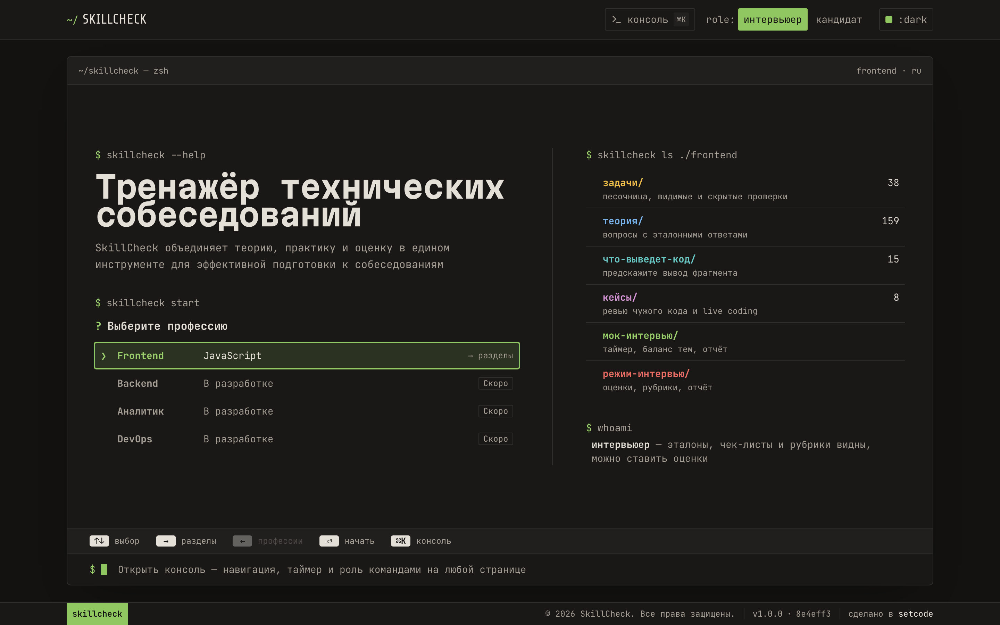
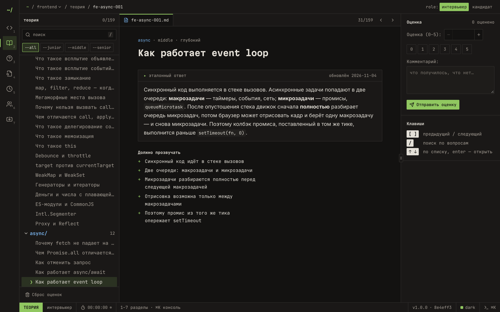
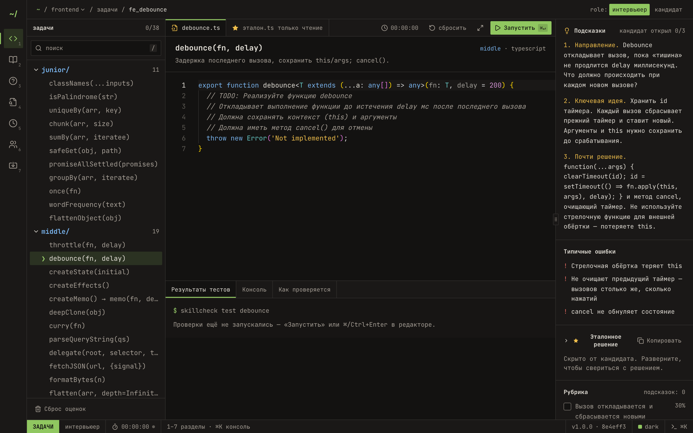

# SkillCheck

[](https://github.com/setcodes/skillCheck/actions/workflows/ci.yml)
[](LICENSE)
[](https://www.typescriptlang.org/)
[](https://react.dev/)
[](https://vitejs.dev/)

Тренажёр технических собеседований с интерфейсом в стиле терминала: теория, задачи с автопроверкой
в песочнице, «Что выведет код?», кейсы ревью и live coding, мок-интервью и режим интервьюера с оценками
и отчётом. Работает целиком в браузере, данные хранятся в `localStorage`.

**Попробовать: [skillcheck.setcode.ru](https://skillcheck.setcode.ru/)** · [Предложить вопрос](https://github.com/setcodes/skillCheck/issues/new?template=question.yml) · [Как помочь](CONTRIBUTING.md)



## Что внутри

Сейчас доступна профессия **Frontend** (Backend, Аналитик и DevOps — в разработке).

| Раздел | Что есть |
|---|---|
| Задачи | 38 задач junior–senior на JS/TS: редактор Monaco, видимые и скрытые проверки в изолированном воркере, подсказки по одной, эталон и рубрика для интервьюера |
| Теория | 159 вопросов по 14 темам: эталонный ответ, «должно прозвучать», типичные ошибки, красные флаги, уточняющие вопросы |
| Что выведет код? | 15 фрагментов с разбором и реальным выводом |
| Кейсы | 8 кейсов: ревью чужого кода с находками по риску и live coding с эталоном |
| Мок-интервью | случайный набор с балансом тем, общий таймер, отчёт по темам и рекомендация уровня, печать в PDF |
| Режим интервью | сводный отчёт по оценкам задач и теории, данные кандидата, печать |
| Импорт / Экспорт | свои вопросы и задачи поверх встроенного банка: импорт из JSON и выгрузка только своих правок |

<table>
  <tr>
    <td></td>
    <td></td>
  </tr>
  <tr>
    <td align="center">Теория — эталон, «должно прозвучать», оценка</td>
    <td align="center">Задачи — редактор, проверки, подсказки и рубрика</td>
  </tr>
</table>

### Роли

- **Кандидат** — решает задачи и проходит мок-интервью; эталоны скрыты, подсказки открываются по одной.
- **Интервьюер** — видит эталоны, чек-листы и рубрики, ставит оценки, ведёт режим интервью.

Роль переключается в шапке. Это режим для двоих за одним экраном, а не защита: эталоны лежат в клиентском бандле.

### Интерфейс

- Главная — экран-терминал: выбор профессии стрелками ↑↓, → в разделы, Enter — открыть.
- Консоль на любой странице — `⌘K` / `Ctrl+K` или `` ` ``: `ls`, `cd задачи`, `timer 45`, `role кандидат`,
  `theme dracula`, `help`; Tab дополняет, ↑↓ — история.
- Внутри разделов: рейл слева (цифры `1–7` переключают разделы), проводник, окно и инспектор справа —
  его ширину можно менять перетаскиванием. `/` — поиск, `[` `]` — предыдущий и следующий элемент.
- Темы: `dark`, `dracula`, `monokai`, `light`.

## Быстрый старт

Нужен Node.js 20 (см. `.nvmrc`).

```bash
npm ci
npm run dev
```

| Команда | Что делает |
|---|---|
| `npm run dev` | dev-сервер Vite |
| `npm run build` / `npm run preview` | сборка и её локальный просмотр |
| `npm run check` | типы, линтер, валидация банка вопросов, unit-тесты, сборка — то же, что в CI |
| `npm test` | unit-тесты (Vitest) |
| `npm run e2e` | e2e-сценарии (Playwright) |
| `npm run validate-questions` | проверка банка вопросов по схеме и покрытие «тема × уровень» |

## Стек

React 18, TypeScript, Vite, Tailwind CSS, shadcn/ui (Radix), React Router, Monaco Editor, Zod,
react-resizable-panels, sonner. Тесты — Vitest и Playwright. Архитектура — Feature-Sliced Design.

## Структура

```
src/
├── app/          # провайдеры (роль, таймер интервью, консоль), оболочка: шапка, рейл, строка состояния
├── pages/        # home, solve, theory, quiz, cases, mock, interview, data-hub
├── features/     # code-editor (Monaco в цветах темы), command-console
├── entities/     # профессии, вопросы, задачи, кейсы, квиз, мок-сессия
└── shared/
    ├── bank/     # банк: встроенные данные + пользовательский слой из localStorage, схемы Zod
    ├── runner/   # песочница: выполнение кода кандидата и проверок в воркере
    ├── questions/ cases/ quiz/   # встроенный контент (JSON)
    ├── api/tasks/                # задачи и их проверки
    └── ui/       # общие компоненты: проводник, инспектор, поля, кнопки, консоль
frozen/           # замороженные профессии (старый формат), вне сборки
deploy/           # Docker-образ, конфиги Nginx и скрипты деплоя
```

## Контент

- Вопросы — `src/shared/questions/frontend.json`, формат и поля описаны в
  [src/shared/questions/README.md](src/shared/questions/README.md).
- Задачи — `src/shared/api/tasks/`, кейсы — `src/shared/cases/frontend.json`, квиз — `src/shared/quiz/frontend.json`.
- Добавление и правка контента — [CONTRIBUTING.md](CONTRIBUTING.md). Любое изменение банка проверяет `npm run validate-questions`.
- Без git вопрос можно предложить через [форму issue](https://github.com/setcodes/skillCheck/issues/new?template=question.yml).

## Деплой

Статический SPA в Docker-образе (Nginx с SPA-fallback, кэшированием и CSP), который ставится за
существующий reverse proxy с Let's Encrypt. Запуск — `./deploy/deploy.sh` со значениями из локального
`deploy/deploy.env` (в `.gitignore`). Подробности — [deploy/README.md](deploy/README.md).

## Разработка

Ветки по gitflow: `feature/*` → `dev` → `main`. Перед PR — `npm run check` и `npm run e2e`.

## Версии

Версия сайта — поле `version` в `package.json` по [semver](https://semver.org/lang/ru/). Она показывается
в футере вместе с коротким хешем коммита (ведёт на GitHub), дата сборки — во всплывающей подсказке.
Отсчёт начат с `1.0.0`.

Перед каждым релизом (PR `dev` → `main`) версию поднимают в ветке `dev`:

```sh
npm version patch --no-git-tag-version   # исправления и правки контента: 1.0.0 → 1.0.1
npm version minor --no-git-tag-version   # новые возможности: 1.0.0 → 1.1.0
npm version major --no-git-tag-version   # несовместимые изменения: 1.0.0 → 2.0.0
```

В том же PR пункты из раздела «Не выпущено» в [CHANGELOG.md](CHANGELOG.md) переносят под номер
версии. После слияния в `main` создают релиз с тегом — описание берётся из CHANGELOG — и выкатывают:

```sh
gh release create vX.Y.Z --target main --title "vX.Y.Z" --notes "$(awk '/^## \[X.Y.Z\]/{f=1;next} /^## \[|^\[/{f=0} f' CHANGELOG.md)"
./deploy/deploy.sh
```

Отдельного workflow для релизов нет: тег ставится вместе с релизом, сборку проверяет CI на `main`.

## Лицензия

MIT — см. [LICENSE](LICENSE).
